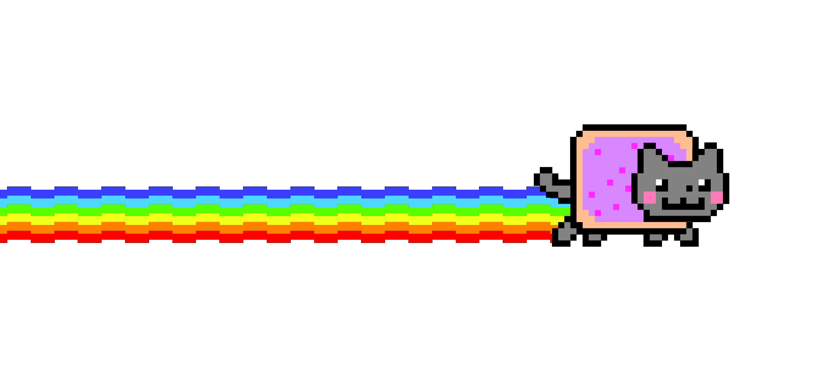

# Sidharth S
**zidhuxd**

Cybersecurity Researcher · Developer · Founder  
Kerala, India

---

> **“Real hackers hack people, not accounts.”**

I'm a cybersecurity researcher and developer focused on clean systems, Android internals, and lightweight web experiences.  
Founder of **[Teen Squad](https://www.teensquad.tech)** and COO at **Hacktura**.

Most of what I build lives in the browser — pure HTML, CSS, and JavaScript. No heavy frameworks.

---

### Currently

- **Security Research** — Android internals, mobile threat intelligence, C2 frameworks  
- **zidhuxd.com** — Performance, PWA patterns, thoughtful interactions  
- **Teen Squad** — Youth tech community & initiatives in Kerala  
- **Open tools** — Small, useful experiments that respect the user

---

### Featured Work

| Project | Description | Status |
|---------|-------------|--------|
| **[WhaleRAT](https://github.com/zidhuxdev/WhaleRAT)** | Dual-mode Android RAT & C2 research framework (Telegram + web) | Active |
| **[KeyDrop](https://github.com/zidhuxdev/KeyDrop)** | Aesthetic web diary maker with personal URLs | Live |
| **[Best Magisk Modules 2026](https://github.com/zidhuxdev/Best-Magisk-Modules-2026)** | Curated Magisk modules with notes & guides | Maintained |
| **[Teen Squad](https://www.teensquad.tech)** | Youth-led tech community platform | Growing |

> WhaleRAT hit **50K+ organic visitors** and helped fund a charity drive that fed hundreds of children through ZidhuGram.

---

### Stack

`JavaScript` · `TypeScript` · `HTML/CSS` · `Kotlin` · `Node.js` · `Android` · `Linux` · `Vercel`

More

- Security: OSINT, ethical hacking, Android internals, Magisk/root ecosystem  
- Web: Static sites, PWA/Service Workers, Core Web Vitals, GSAP  
- Philosophy: Minimal over heavy frameworks. Documentation as a first-class citizen.

---

---

### Elsewhere

- Portfolio → [zidhuxd.com](https://zidhuxd.com)  
- Teen Squad → [teensquad.tech](https://www.teensquad.tech)  
- Research → [orcid.org/0009-0004-0138-1965](https://orcid.org/0009-0004-0138-1965)  
- Contact → zidhuxd@gmail.com

---

Thanks for stopping by.  
⭐ Star a repo if something was useful.

*Updated November 2026*

